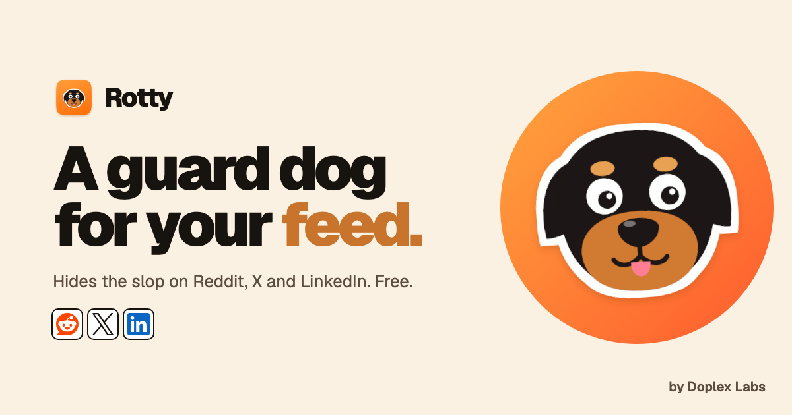
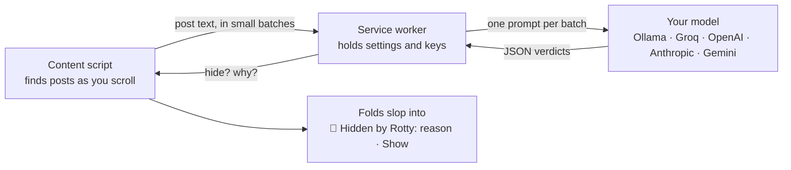

<p align="center">
  
</p>

<h1 align="center">Rotty Lite</h1>

<p align="center">
  <b>A guard dog for your feed.</b> The open-source version of <a href="https://getrotty.vercel.app">Rotty</a>, by <a href="https://github.com/DoplexLabs">Doplex Labs</a>.<br />
  A Chrome extension that hides low-effort posts and replies on Reddit, X and LinkedIn, using a model that runs on your computer or your own API key.
</p>

<p align="center">
  <a href="https://github.com/DoplexLabs/rotty-open-source/actions/workflows/ci.yml"></a>
  <a href="LICENSE"></a>
  
</p>

---

## Why

Feeds are filling up with *slop*: replies that say nothing ("Great question! This really resonates 🙌"), engagement bait ("Comment YES and I'll send you my framework"), drive-by plugs and spam. It's cheap to produce and it buries the people who actually have something to say.

Rotty reads each post the way a person would and folds the slop away, leaving one quiet line that says why. Good posts stay, and anything hidden is a click away.

```
@someone  Shipped dark mode today. Took 3 weeks because we had 400 hardcoded colors.
🐾 Hidden by Rotty: generic filler                                            [Show]
@someone  Tip: use CSS variables from day one and flip them with prefers-color-scheme.
🐾 Hidden by Rotty: engagement bait                                           [Show]
```

## Quick start

**1. Get the extension.** Download `rotty-lite-<version>.zip` from the [latest release](https://github.com/DoplexLabs/rotty-open-source/releases/latest) and unzip it, or clone this repo.

**2. Load it in Chrome.** Open `chrome://extensions`, turn on **Developer mode**, click **Load unpacked** and pick the unzipped folder (or `extension/` in the repo).

**3. Pick a model.** Settings open on install. Choose one:

| Model | Cost | Privacy | Setup |
|---|---|---|---|
| **Ollama** (default) | Free | Runs on your computer; nothing leaves it | Install [Ollama](https://ollama.com), then `ollama pull llama3.2` and start it with `OLLAMA_ORIGINS=chrome-extension://* ollama serve` |
| **Groq** | Free key | Post text goes to Groq | Paste a key from [console.groq.com](https://console.groq.com) |
| **OpenAI**, **Anthropic**, **Gemini** | Your API usage | Post text goes to that provider | Paste your API key |

Click **Test**. When it says *"Works: it hid the slop and kept the useful reply"*, open Reddit, X or LinkedIn and scroll.

## How it works



| File | What it does |
|---|---|
| [`extension/sites.js`](extension/sites.js) | Where posts and replies live on each site, as CSS selectors. Sites change often; this is the file to fix when one breaks. |
| [`extension/content.js`](extension/content.js) | Finds new posts as you scroll, batches them, and folds the ones judged to be slop. Reads post text only, never usernames. |
| [`extension/prompt.js`](extension/prompt.js) | The reference prompt: what counts as slop, three strictness levels, and a tolerant parser for the model's JSON. |
| [`extension/providers.js`](extension/providers.js) | One small adapter per provider. Requests go straight from your browser to the provider you pick. |
| [`extension/background.js`](extension/background.js) | The service worker. Only it talks to the model; it ignores messages from web pages and caches verdicts so scrolling back is free. |

The whole extension is about 600 lines of plain JavaScript, with no build step and no dependencies.

## Privacy

- **Ollama:** nothing leaves your computer.
- **Any other provider:** only the text of each post (and which site it's from) is sent, straight from your browser to the provider you chose, under their privacy policy. Usernames, cookies and browsing history are never sent.
- Your settings and API keys stay in your browser's extension storage. Keys are sent only to their own provider.
- There is no Rotty server, no account, no analytics and no tracking.

## Rotty Lite and Rotty

Rotty Lite is a small, readable starting point for tinkering. [Rotty](https://getrotty.vercel.app), the full extension on the Chrome Web Store, adds Rotty Local (a small model trained for this, running in your browser), a tuned per-site taxonomy, Continue with ChatGPT, allowlists and more.

| | Rotty Lite (this repo) | Rotty |
|---|---|---|
| Reddit, X, LinkedIn | ✓ | ✓ |
| Your own API key | ✓ | ✓ |
| Local model | via Ollama | Rotty Local, built in |
| Prompt | Reference prompt | Tuned per site |
| Continue with ChatGPT | | ✓ |
| License | MIT | Proprietary |

## Develop

```bash
npm test          # unit tests for the prompt parser and providers (Node 20+, no install needed)
npm run package   # builds dist/rotty-lite-<version>.zip
```

Edit files in `extension/`, then click the reload icon on the extension in `chrome://extensions`.

Ideas for a first contribution: fix a site's selectors in `sites.js`, add a site, try a better prompt in `prompt.js`, or add a provider in `providers.js`. See [CONTRIBUTING.md](CONTRIBUTING.md).

## License and trademarks

The code is released under the [MIT License](LICENSE). The **Rotty** name and the Rotty dog logo are trademarks of Doplex Labs and are not covered by the license: if you publish a fork, please give it a different name and icon.

Reddit, X, LinkedIn, Ollama, Groq, OpenAI, Anthropic and Gemini are trademarks of their owners and are mentioned only to say what Rotty Lite works with.

<p align="center"><sub>Made by <a href="https://github.com/DoplexLabs">Doplex Labs</a> · Also from us: <a href="https://getbelay.vercel.app">Belay</a></sub></p>
